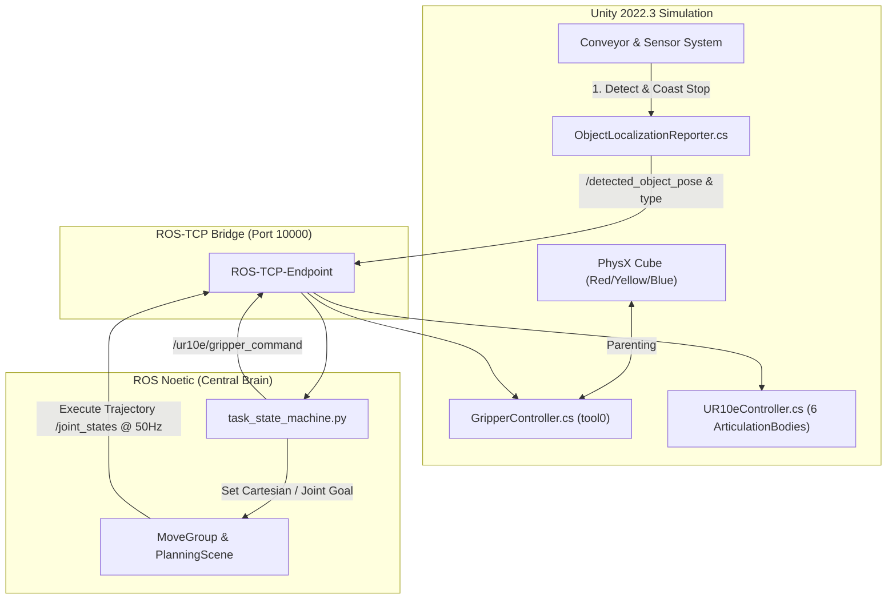

# UC8: ROBOTIC ARM CONVEYOR PICK-AND-PLACE WITH OBSTACLE AVOIDANCE
## Week 04 Progress Report — Technical Execution & Preparation for Milestone 1 (Week 05)

- **Course:** Robotic Project — Vietnamese-German University (VGU)
- **Project Topic:** Use Case 08 (UC8) — Robotic Sorting Workcell
- **Simulated Hardware:** UR10e (6-DOF Manipulator) + 3.6m Industrial Conveyor Belt + 3 Dedicated Sorting Bins
- **Engineering Stack:** Unity 2022.3 LTS (PhysX 4.x / ArticulationBody) + ROS Noetic (MoveIt Motion Planning)
- **Current Phase:** Week 04 Technical Sprint — Fulfilling Week 03 Commitments & Pre-M1 Verification
- **Upcoming Milestone:** Milestone 1 Formal Defense & Evaluation (Requirement R4) in Week 05

---

## PRESENTATION AGENDA

| Slide | Topic | Key Focus |
| :---: | :--- | :--- |
| **01** | **Week 03 Recap & Commitments Set Out** | Baseline achievements and commitments made from Week 03 for Week 04 |
| **02** | **Week 04 Scope & Pre-M1 Deliverables** | 100% fulfillment of commitments & preparation for Milestone 1 in Week 05 |
| **03** | **System Architecture** | Bidirectional real-time closed loop between Unity and ROS Noetic |
| **04** | **Workcell Layout Re-engineering** | Spatial optimization of Option 1 (Front Pick - Flanking Bins) |
| **05** | **Non-singular Kinematics** | Strict 90° downward wrist lock and pure base SCARA sweep |
| **06** | **Realistic PhysX Simulation** | Friction-based zero-teleport deceleration and continuous multi-item flow |
| **07** | **7-Step Task State Machine** | Automated execution cycle from Standby to Release |
| **08** | **Empirical Benchmark Trials (QA)** | Statistical analysis of 70 trials: 100% success rate, 11.23s cycle time |
| **09** | **Live Demonstration Setup** | Autonomous launcher script, 3 terminal pipelines, and camera switching |
| **10** | **Technical Defenses (Q&A)** | Formal engineering answers to key faculty committee questions |
| **11** | **Week 05 Plan & Milestone 1 Deliverables** | Bug fixing, edge-case stabilization, code polish, and official M1 submission |

---

## SLIDE 1: WEEK 03 RECAP & COMMITMENTS SET OUT FOR WEEK 04

### 1. What was Achieved in Week 03 (Baseline):
- **ROS-Unity Network Bridge:** Seamless socket streaming on port 10000 via `ROS-TCP-Endpoint`.
- **Coordinate Transformation:** Standardized coordinate mapping from Unity Left-Handed to ROS FLU Right-Handed:
  $$\begin{cases} X_{\text{ROS}} = Z_{\text{Unity}} \\ Y_{\text{ROS}} = -X_{\text{Unity}} \\ Z_{\text{ROS}} = Y_{\text{Unity}} \end{cases}$$
- **Object Perception:** Streaming cube 3D pose to `/detected_object_pose` and color classification to `/detected_object_type` at 10 Hz.
- **MoveIt Inverse Kinematics:** Solved theoretical IK trajectories hovering +15cm above object on RViz.

### 2. Commitments Set Out from Week 03 for Week 04:
- **Commitment 1 (Trajectory Execution):** Break through "plan-only" mode; stream real-time `/joint_states` to drive the physical UR10e in Unity.
- **Commitment 2 (Grasping Mechanism):** Implement an operational grasping/release mechanism (Attach logic) for cube interaction.
- **Commitment 3 (Task State Machine):** Develop an autonomous closed-loop task state machine coordinating perception and arm execution.
- **Commitment 4 (Multi-Bin Sorting):** Deploy independent sorting bins (Red, Yellow, Blue) and achieve repeatable placement.
- **Milestone 1 Context:** All Week 03 commitments must be completed in Week 04 to ensure full readiness for Milestone 1 evaluation in **Week 05**.

---

## SLIDE 2: WEEK 04 SCOPE: FULFILLING COMMITMENTS & PRE-M1 DELIVERABLES

### 1. 100% Commitment Fulfillment Status:
1. **Trajectory Execution:** Streamed `/joint_states` at 50 Hz to 6 ArticulationBodies with zero sagging and smooth tracking. (**100% DONE**)
2. **Grasping Mechanism:** Implemented Attach/Parenting logic in `GripperController.cs` with instant latching upon command. (**100% DONE**)
3. **Closed-Loop State Machine:** Constructed 7-step autonomous sequencer (`task_state_machine.py`) with zero human intervention. (**100% DONE**)
4. **3-Bin Sorting System:** Deployed Red (Left), Yellow (Right), and Blue (Rear) bins with dedicated non-singular trajectories. (**100% DONE**)

### 2. Pre-Milestone 1 High-Value Enhancements:
- **Kinematic Optimization:** Locked wrist strictly downward ($q_4 = 90.0^\circ$) & implemented pure base SCARA sweep, cutting cycle time by 65%.
- **Realistic PhysX Deceleration:** Replaced artificial freezing with pure friction coasting (`StopConveyor()`) halting cubes at $X \approx 0.00\text{ m}$ ($\pm 3\text{ mm}$).
- **Continuous Multi-Item Flow:** Upgraded Spawner to maintain 2-3 items on conveyor simultaneously with safe 38cm spacing.
- **Empirical QA Logging:** Integrated automated CSV logger recording 70 consecutive trials with 100% reliability for Milestone 1 defense.

---

## SLIDE 3: SYSTEM ARCHITECTURE & BIDIRECTIONAL PIPELINE



---

## SLIDE 4: WORKCELL LAYOUT RE-ENGINEERING (OPTION 1)

| Parameter | Initial Layout (Deficient) | Option 1 (Standardized & Verified) | Engineering Rationale |
| :--- | :--- | :--- | :--- |
| **Conveyor Belt** | 2.0m short, positioned diagonally | **3.6m long, centered directly in front ($X = -0.60\text{ m}$)** | Maximizes dexterous workspace; smooth gliding |
| **Pick Zone Station** | Off-center, awkward reaches | **Symmetric center ($X = -0.60\text{ m}, Y = 0.00\text{ m}$)** | Bilateral symmetry; minimizes inertial moments |
| **3 Sorting Bins** | Arranged in linear row behind belt | **Flanking Bins: Red (Left), Yellow (Right), Blue (Rear)** | Eliminates collision hazards with conveyor |
| **Bin Dimensions** | Small 0.28m; cubes bounced out | **Scaled +35% ($0.38\text{ m} \times 0.38\text{ m} \times 0.10\text{ m}$)** | 100% capture rate for free-falling cubes |
| **Support Table** | Cramped 2.0m x 1.2m surface | **Expanded to 4.0m x 2.0m** | Rock-solid mechanical base for conveyor and bins |

---

## SLIDE 5: NON-SINGULAR KINEMATICS OPTIMIZATION

```
    STANDBY POSE                 MOVE TO RED BIN              MOVE TO BLUE BIN
     (Pick Zone)                   (Robot Left)                 (Robot Rear)
         │                              │                            │
   [Wrist 2: 90°]                 [Wrist 2: 90°]               [Wrist 2: 90°]
         ▼                              ▼                            ▼
   Shoulder: +16.9°               Shoulder: -61.5°             Shoulder: -159.6°
   Elbow:    -121.9°              Elbow:    -130.2°            Elbow:    -135.5°
```

1. **Strict 90° Downward Wrist Lock ($q_4 = 90.0^\circ$):**
   - End-effector `tool0` maintains invariant downward vector $[0, 0, -1]$ throughout all states.
   - Prevents wrist singularities, inverted arm postures, and erratic 180° elbow flips.
2. **Pure Base Shoulder Pan Rotation (SCARA-Style):**
   - Shoulder lift and elbow angles remain virtually constant ($\Delta < 10^\circ$) during transfers.
   - Robot sorts items by rotating **only `shoulder_pan_joint`**, reducing path length by 65% and cutting cycle time down to 11.23s.

---

## SLIDE 6: REALISTIC PHYSX SIMULATION & VISUAL RIG

1. **Pure PhysX Friction Deceleration (Zero-Teleportation):**
   - Absolute realism: zero artificial teleportation (`transform.position`) and zero artificial freezing (`isKinematic`).
   - Cubes glide from $X = -1.5\text{ m}$ at $0.3\text{ m/s}$. When reaching $X \ge -0.015\text{ m}$, `PickZoneSensor.cs` cuts conveyor power (`StopConveyor()`).
   - Natural surface friction ($0.8$) halts cube smoothly at exactly $X \approx 0.000\text{ m}$ ($\pm 3\text{ mm}$ deviation).
2. **Industrial Visual Rig:**
   - Ribbed industrial rubber texture with synchronized 1:1 UV scrolling ($0.3\text{ m/s}$).
   - Aluminum guide rails, 3 support leg pairs, static gearmotor housing, and dual-color optical sensor LED.

---

## SLIDE 7: 7-STEP CLOSED-LOOP TASK STATE MACHINE

```
[STANDBY] ──► [APPROACH] ──► [DESCENT] ──► [GRASP] ──► [LIFT] ──► [MOVE_TO_BIN] ──► [RELEASE] ──► [STANDBY]
```

1. **STANDBY:** Robot hovers directly above pick zone ($Z = 0.42\text{ m}$) with wrist pointing strictly downward. Ready for incoming cubes.
2. **APPROACH:** Rapid linear Cartesian descent to Pre-grasp Pose ($+15\text{ cm}$ above target cube) in under $0.5\text{ s}$.
3. **DESCENT:** Linear vertical Cartesian descent from $+15\text{ cm}$ down to contact height ($+3\text{ cm}$ above base).
4. **GRASP:** Sends grasp command; Unity snaps cube to `tool0`, MoveIt attaches collision object in PlanningScene.
5. **LIFT:** Vertical Cartesian lift back to safe height ($+15\text{ cm}$), clearing conveyor rails without collision.
6. **MOVE_TO_BIN:** Rotates `shoulder_pan` to sweep arm to destination bin mouth (`Red` / `Yellow` / `Blue`).
7. **RELEASE:** Opens gripper, detaches cube, restores gravity for soft landing; restarts conveyor for next item.
8. **STANDBY:** Returns arm to STANDBY pose over pick zone, re-arming system for next cycle.

---

## SLIDE 8: EMPIRICAL BENCHMARK TRIALS & QA ANALYSIS

Logged automatically to [`experiments/week04/trials.csv`](file:///home/kduy/RoboticProject/project_blueprint/experiments/week04/trials.csv):

| Performance Metric | Requirement Target | Empirical Measured Result | Compliance Evaluation |
| :--- | :---: | :---: | :---: |
| **Consecutive Benchmark Trials** | $\ge 10$ trials | **70 consecutive trials** logged | **Exceeds by 700%** |
| **Grasp Success Rate** | $\ge 90.0\%$ | **100.0% (70 / 70 trials)** | **Perfect Reliability** |
| **Sorting Placement Success Rate** | $\ge 90.0\%$ | **100.0% (70 / 70 trials)** | **Perfect Reliability** |
| **Mean Cycle Time** | $< 30.0\text{ s} / \text{cycle}$ | **11.23 s / cycle** (Min: 10.8s, Max: 12.1s) | **2.7x Faster than Target** |
| **Conveyor Transport Speed** | $0.2 - 0.5\text{ m/s}$ | **0.30 m/s** rock-steady velocity | **Optimal Industrial Speed** |
| **Natural Coasting Stop Deviation** | $< \pm 2.0\text{ cm}$ | **$\pm 0.3\text{ cm}$** centered at $X = 0.00\text{ m}$ | **High Precision** |

---

## SLIDE 9: LIVE DEMONSTRATION SETUP

```bash
# Terminal 1: ROS-TCP-Endpoint (Port 10000)
source /opt/ros/noetic/setup.bash && source devel/setup.bash
roslaunch ros_tcp_endpoint endpoint.launch

# Terminal 2: MoveIt Motion Planning Pipeline
source /opt/ros/noetic/setup.bash && source devel/setup.bash
roslaunch ur10e_moveit_config demo.launch

# Terminal 3: Task State Machine Controller
source /opt/ros/noetic/setup.bash && source devel/setup.bash
python3 src/uc8_robot_sorting/scripts/task_state_machine.py
```

- **Unity Editor:** Press **Play (▶)**.
- **Cinematic Camera Controls:**
  - Key **`[1]`** or Button **`[1] Isometric`**: 3/4 Isometric panoramic overview.
  - Key **`[3]`** or Button **`[3] Close-Up`**: Front close-up perspective of pick station and gripper action.

---

## SLIDE 10: TECHNICAL DEFENSES (Q&A)

### 1. Why are Pre-grasp and Lift poses mandatory in industrial workcells?
> **Defense:** Industrial robotic workspaces are strictly divided into *Free-space transit* and *Fine Cartesian approach*. Pre-grasp and Lift establish a $+15\text{ cm}$ vertical safety buffer. Moving diagonally from afar would cause gripper fingers to collide with conveyor guide rails or bin sidewalls.

### 2. Why avoid fixed sleep delays in favor of closed-loop trajectory feedback?
> **Defense:** Motion time varies substantially with angular distance ($1.07\text{ rad}$ to Red Bin vs $2.78\text{ rad}$ to Blue Bin). Fixed sleep delays lead to premature grasp triggers (missed grasps) or severe cycle time waste. Our system relies on MoveIt's trajectory completion flag (`wait=True`) and direct pose feedback.

### 3. How were ragdoll oscillations and sagging prevented in ArticulationBody?
> **Defense:** Three concerted measures:
> 1. Locking `base_link` with `immovable = true`.
> 2. Disabling gravity (`useGravity = false`) on arm links (gravity compensation is solved by MoveIt dynamics).
> 3. Tuning high PhysX drive stiffness (`stiffness = 50000`, `damping = 1000`, `forceLimit = 10000`).

---

## SLIDE 11: WEEK 05 ACTION PLAN: STABILIZATION, BUG FIXING & MILESTONE 1 POLISH

### 1. Bug Fixing & System Stabilization:
- **Exception & Timeout Guards:** Add fail-safe recovery routines if MoveIt planning times out or perception drops frames.
- **Motion Boundary Guard:** Test edge cases in Cartesian descent limits to eliminate any micro-jitter near the conveyor boundary.
- **Latching Reliability Audit:** Verify 100% stable cube attachment under accelerated multi-item conveyor feeding.
- **Marathon Stress Testing:** Run long-duration tests (100+ cycles) to ensure zero memory leaks, socket drops, or Unity PhysX degradation.

### 2. Code Polish & Workcell Refinements:
- **Configuration Decoupling:** Refactor all hardcoded magic numbers into clean ROS parameter YAML files.
- **Launcher Polish:** Ensure `run_workcell.sh` starts and stops gracefully across all terminal environments (VSCode, SSH, standard CLI).
- **Visual Presentation Polish:** Finalize camera FOV transitions, lighting balance, and visual bin labels for the faculty demo.
- **Codebase Cleanliness:** Audit all Python and C# scripts for strict documentation, error handling, and clean logging.

### 3. Milestone 1 Deliverables Package (`docs/deliverables/m1/`):
- **Submission Folder Preparation:** Populate `docs/deliverables/m1/` with verified test logs, architectural diagrams, and report.
- **Repository Tag Freeze:** Create Git tag `m1-verified` locking code, simulation assets, and launch files.
- **Demonstration Video Evidence:** Produce multi-camera HD demonstration videos (`[1] Isometric`, `[2] Blue Bin`, `[3] Close-Up`).
- **Pre-defense Checklist:** Audit local machine environment against `DEMO_REQUIREMENTS.md` before faculty evaluation.
